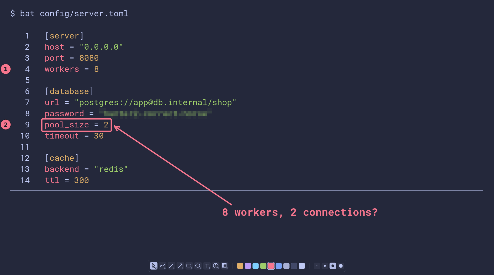
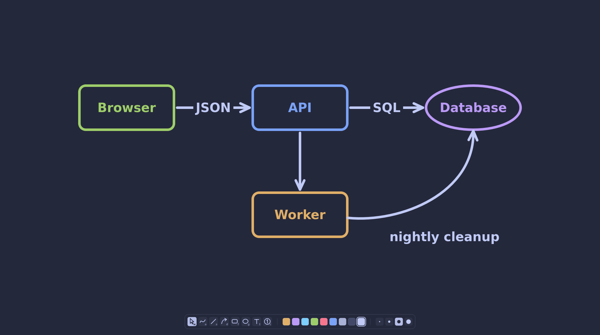
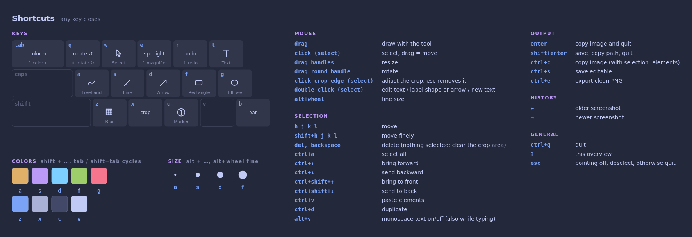

# griffel

[](https://github.com/wabohu/griffel/actions/workflows/tests.yml)

A screenshot annotation tool and whiteboard for Linux. I wanted something like
Epic Pen or Tekapoint on my own X11 desktop, something I could change whenever
it got in my way. This is it.

griffel (say GRIF-ul) is German for the stylus you write on a slate with.



Press a hotkey and griffel freezes the current monitor. Draw arrows, boxes and
notes on top, blur what nobody should see, then paste the result wherever it
needs to go. Without a screenshot it's a whiteboard for quick sketches and
diagrams.

It's made for the keyboard and a tiling window manager (herbstluftwm and sxhkd
in my case). It needs X11; see [Tested on](#tested-on).

## What it can do

**Drawing**
- Freehand, lines, arrows, rectangles, ellipses and text, also in a monospace
  font for code and commands
- Numbered or lettered markers that renumber themselves
- Blur to pixelate passwords, names and the like
- Erase an area by filling it with the color around it
- Text inside shapes and on arrows
- Spotlight and magnifier for pointing at things while sharing your screen

**Editing**
- Select one or many elements, move, resize, rotate, recolor, change their order
- Copy, paste and duplicate, also between a screenshot and a whiteboard
- Undo and redo for everything

**Saving**
- Copy to the clipboard or save as PNG, the whole screen or just a cropped area
- Saved files stay editable: the drawing data is stored inside the PNG, so any
  image viewer still shows a normal picture
- Every screenshot you've changed is kept in a history, so yesterday's
  annotation can still be edited today

**Whiteboard**



- Endless canvas with pan and zoom, dark or light background
- Arrows stick to shapes and follow them when you move things around
- On a light background colors are darkened automatically so they stay readable

**Setup**
- Colors and the monospace font come from your Alacritty config if you have one; otherwise a built-in palette, and your own colors in the TOML file
- Keys, tools, colors and sizes can be changed in a TOML file
- Scales with the screen, so it stays usable on 4K

## Install

### Arch Linux

griffel will be in the AUR with its first release (0.1.0):

```sh
yay -S griffel
```

### From source

```sh
sudo pacman -S pyside6 xclip xdotool        # Arch; optional: libnotify rofi
git clone https://github.com/wabohu/griffel.git
ln -s "$PWD/griffel/run.py" ~/.local/bin/griffel
```

`run.py` starts griffel straight from the source folder, so `git pull` updates it.

### Requirements

- Linux with X11 (see [Tested on](#tested-on))
- Python 3.11 or newer and PySide6
- `xclip` for the clipboard. Without it the copied image is gone when griffel quits
- `xdotool` (or `wmctrl`) to give the keyboard focus back when the screenshot overlay
  closes. Only with herbstluftwm it works without them (via `herbstclient`)
- Optional: `notify-send` with a notification daemon like dunst, and `rofi` for prompts.
  Without them griffel falls back to its own Qt dialogs

## Getting started

```sh
griffel              # annotate a screenshot of the monitor under the mouse
griffel --board      # empty whiteboard in a normal window
griffel --last       # open the latest screenshot from the history
griffel image.png    # open a saved drawing or any PNG
griffel --version
```

Put `griffel` on a global hotkey, that's how it's meant to be used (examples
below). Inside, `?` shows all keys and Esc quits. How everything works is
explained in [docs/usage.md](docs/usage.md).



### Global hotkey

The examples use Super+Shift+S for a screenshot and Super+Shift+W for the
whiteboard; `griffel --last` (latest screenshot from the history) is worth a key
too. Your window manager has to find `griffel` in its `PATH`. Many don't see
`~/.local/bin` when they aren't started from a login shell, so if nothing
happens, use the absolute path.

<details>
<summary>sxhkd (also bspwm)</summary>

```
super + shift + s
    griffel
super + shift + w
    griffel --board
```

Reload with `pkill -USR1 sxhkd`.
</details>

<details>
<summary>i3</summary>

```
bindsym $mod+Shift+s exec --no-startup-id griffel
bindsym $mod+Shift+w exec --no-startup-id griffel --board
```

Without `--no-startup-id`, i3 shows a busy cursor until it gives up waiting for
a startup notification. Check that your config doesn't use these keys already.
</details>

<details>
<summary>herbstluftwm</summary>

```sh
hc keybind Mod4-Shift-s spawn griffel
hc keybind Mod4-Shift-w spawn griffel --board
```
</details>

<details>
<summary>awesome</summary>

In `globalkeys` in `rc.lua`:

```lua
awful.key({ modkey, "Shift" }, "s", function () awful.spawn("griffel") end,
          { description = "annotate a screenshot", group = "launcher" }),
awful.key({ modkey, "Shift" }, "w", function () awful.spawn("griffel --board") end,
          { description = "whiteboard", group = "launcher" }),
```
</details>

<details>
<summary>Openbox</summary>

In the `<keyboard>` section of `rc.xml`, then `openbox --reconfigure`:

```xml
<keybind key="W-S-s">
  <action name="Execute"><command>griffel</command></action>
</keybind>
<keybind key="W-S-w">
  <action name="Execute"><command>griffel --board</command></action>
</keybind>
```
</details>

<details>
<summary>xbindkeys (any window manager)</summary>

In `~/.xbindkeysrc`:

```
"griffel"
    Mod4+Shift + s
"griffel --board"
    Mod4+Shift + w
```
</details>

<details>
<summary>KDE Plasma, GNOME, Xfce, Cinnamon</summary>

Add a custom shortcut with the command `griffel` in the keyboard settings
(KDE: System Settings → Keyboard → Shortcuts → Add New → Command or Script;
GNOME: Settings → Keyboard → Custom Shortcuts; Xfce: Keyboard → Application
Shortcuts). GNOME and KDE start a Wayland session by default, where griffel
refuses to take screenshots: choose the X11/Xorg session when logging in.
</details>

## Configuration

Settings live in `~/.config/griffel/config.toml`. Every option is explained in
[config.example.toml](config.example.toml). You don't need the file at all,
anything missing falls back to the defaults.

The default keys are laid out for QWERTY. On QWERTZ you may want to swap `z`
and `y` under `[keys]`. The keyboard picture in the overview (`?`) follows your
layout and can show a split or ortho keyboard instead (`[help]`).

### Clashes with your window manager

griffel doesn't grab the keyboard, so your global hotkeys keep working while
it's open. The flip side: whatever your window manager binds never reaches
griffel. If Alt is your window manager's modifier (common with i3, Openbox,
awesome), the size keys Alt+A S D F and Alt+V (monospace text) are lost; i3's
default config, for one, uses exactly these. Move them in the config:

```toml
[keys]
size_1 = "ctrl+1"
size_2 = "ctrl+2"
size_3 = "ctrl+3"
size_4 = "ctrl+4"
text_font = "ctrl+m"
```

The overview (`?`) then shows the new keys. Alt+wheel (fine size adjustment)
can't be changed; few window managers bind it.

## Tested on

- **Works, tested:** Arch Linux on X11 with herbstluftwm and i3
- **Should work, not tested:** other window managers and desktops on Xorg (KDE
  Plasma, Xfce, GNOME on Xorg). The part most likely to go wrong there is giving
  the keyboard focus back when the screenshot closes. Bug reports are welcome
- **Doesn't work:** Wayland, also via XWayland. griffel refuses to take a
  screenshot there and says so (exit code 2); only the whiteboard opens. If your
  setup can take screenshots anyway, `GRIFFEL_IGNORE_WAYLAND=1` skips that check

## Privacy

- Saved drawings (Ctrl+S, Shift+Enter) carry their editing data inside the PNG,
  including the screenshot below the markings. With a crop, only the cropped part
  is stored, unless you set `[output] keep_full_screenshot = true`. Blurred areas
  are burned in, so they can't be recovered from the file.
- The history in `~/.local/share/griffel/history` keeps the whole screenshot of
  every image you changed, by default the last 100. Turn it off or shorten it
  under `[history]`.
- To pass an image on, Ctrl+E exports a plain PNG without any editing data.

Details in [docs/file-format.md](docs/file-format.md).

## Documentation

- [Using griffel](docs/usage.md): every feature, and a key reference
- [Troubleshooting](docs/troubleshooting.md)
- [File format](docs/file-format.md): what a saved PNG contains
- [Changelog](CHANGELOG.md)
- [Contributing](CONTRIBUTING.md): bug reports, tests, how the code is organized

## License

GPL-3.0-or-later, see [LICENSE](LICENSE).
